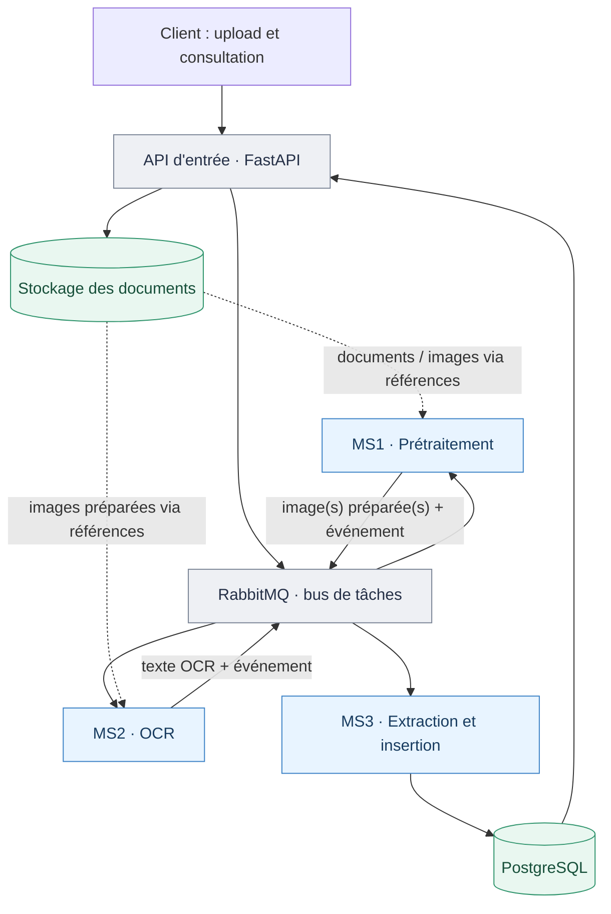
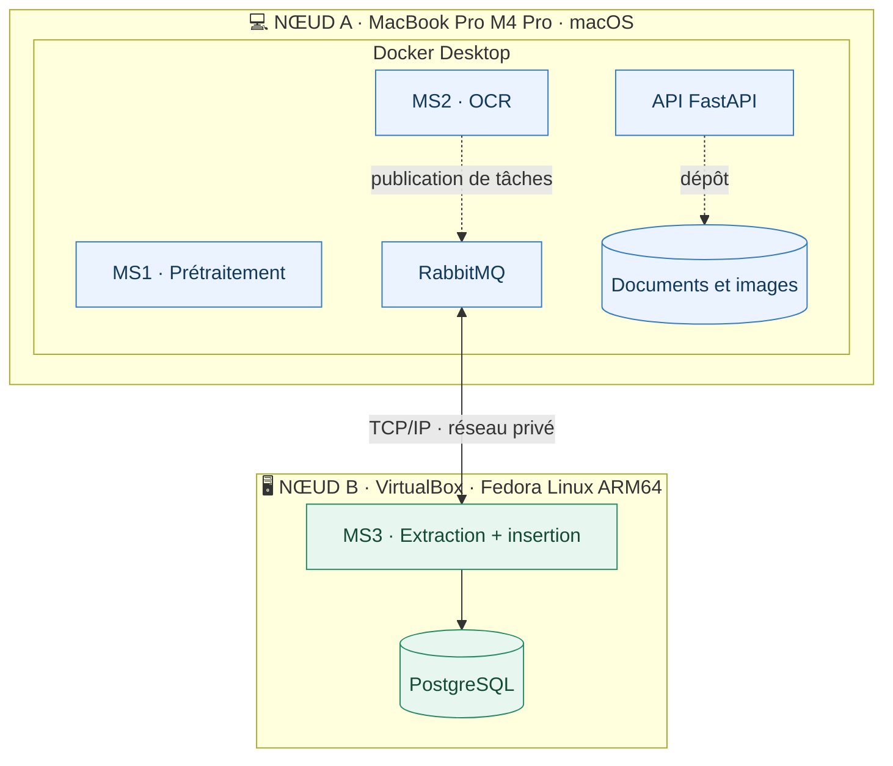
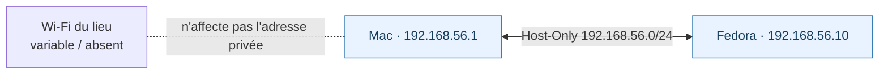
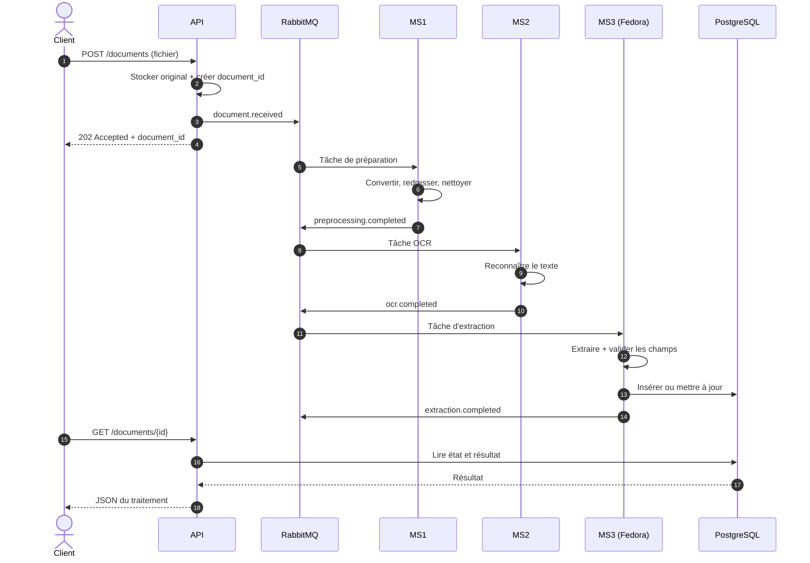
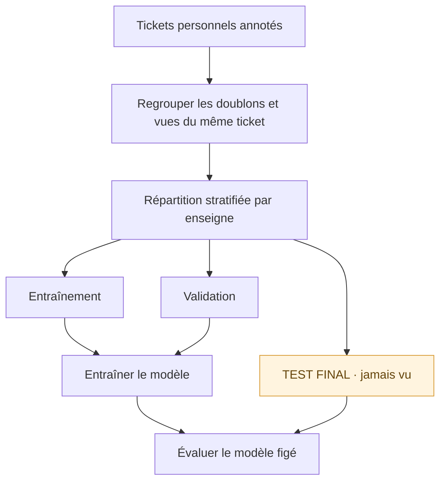

# DOCFLOW AI

> **Cahier des charges fonctionnel et technique**  
> *Du ticket de caisse brut à des données fiables — grâce à trois microservices distribués.*
>
> **Version :** 1.0 · **Date :** 16 novembre 2026  
> **Cadre :** Projet de Master 2 S2IN — Systèmes distribués  
> **Destinataires :** équipe projet, encadrants, client et assistant de développement (Claude Code)  
> **Statut :** spécification de réalisation ; les hypothèses à confirmer sont identifiées en fin de document.

---

## ✨ Le projet en 30 secondes

DocFlow AI permet de **déposer une photo ou un PDF de ticket de caisse**, de **reconnaître automatiquement son contenu**, puis de **sauvegarder trois informations** : l'**enseigne**, la **date** et le **montant total**.

L'intérêt principal du projet n'est pas l'interface : il s'agit de **concevoir et évaluer une chaîne de traitement IA distribuée** entre un **MacBook Pro M4 Pro** et une **machine virtuelle Fedora Linux**. L'application comprend **trois microservices métier**, développés en Python, et des composants techniques d'appui.

| Question | Réponse |
|:---|:---|
| **Que dépose-t-on ?** | Un document non structuré : JPG, PNG ou PDF. |
| **Que récupère-t-on ?** | Entité (`CARREFOUR`, `LIDL`, `INTERMARCHÉ`), date, montant total. |
| **Sur quelles données ?** | Tickets personnels des trois enseignes, annotés pour l'entraînement et les tests. |
| **Comment les traitements sont-ils répartis ?** | MS1 et MS2 en Docker sur macOS ; MS3 dans une VM Fedora. |
| **Où sont les données ?** | Documents et résultats intermédiaires côté Mac ; résultats structurés dans PostgreSQL côté Fedora. |
| **Comment les services se parlent-ils ?** | Par messagerie asynchrone RabbitMQ, sur le réseau TCP/IP. |
| **Comment valide-t-on le résultat ?** | Tests fonctionnels, comparaison aux annotations, tests de panne et mesures de performance / d'énergie. |

> **Notre principe :** *une étape = un rôle clair = un microservice testable indépendamment.*

---

# 1. Contexte, besoin et objectifs

## 1.1. Problème à résoudre

Les tickets de caisse se présentent sous des formes hétérogènes : photos inclinées, contrastes variables, impressions effacées, PDF ou images. Les informations existent sur le document, mais elles ne sont **pas directement structurées pour une base de données**.

DocFlow AI transforme un document brut en un enregistrement exploitable. Le système doit fonctionner de manière reproductible lors d'une démonstration, **sans dépendre du réseau Wi-Fi du lieu**.

## 1.2. Objectifs pédagogiques

1. Mettre en œuvre une **architecture client–serveur en trois briques** : présentation, logique applicative et gestion des données.
2. Décomposer un pipeline de traitement en **trois microservices aux responsabilités distinctes**.
3. **Distribuer les traitements** sur au moins deux nœuds logiques et réaliser des échanges réseau réels.
4. Combiner **conteneurisation Docker** et **virtualisation VirtualBox**.
5. **Répartir les données** entre les environnements d'exécution et expliciter ce que signifie cette répartition.
6. Évaluer la **qualité de reconnaissance/extraction**, la **performance système** et le **coût environnemental estimé**.
7. Démontrer le comportement du pipeline en cas de panne d'un service.

## 1.3. Objectifs fonctionnels

- Déposer un ticket au format **PDF, JPG/JPEG ou PNG**.
- Préparer l'image pour améliorer les chances de reconnaissance.
- Reconnaître le texte présent sur le ticket (OCR).
- Extraire **l'enseigne / entité**, **la date du ticket** et **le montant total TTC ou total payé**.
- Vérifier, normaliser et enregistrer ces trois champs dans PostgreSQL.
- Afficher ou récupérer le statut d'un traitement et son résultat.
- Entraîner une solution d'extraction sur les tickets annotés disponibles, puis la tester sur des tickets **jamais vus pendant l'entraînement**.

## 1.4. Périmètre

**Inclus** : trois enseignes initiales (*Carrefour*, *Lidl*, *Intermarché*), documents PDF/images, pipeline Python, trois microservices, communications distribuées, gestion des erreurs, stockage, entraînement et évaluation, rapport de mesures.

**Non prioritaire / hors périmètre V1** : interface graphique élaborée, application mobile, traitement de vidéo/audio, comptabilité, suivi de stocks, déploiement cloud, authentification multi-utilisateur avancée, orchestration Kubernetes, haute disponibilité réelle sur plusieurs serveurs physiques.

> La prise en charge d'une nouvelle enseigne pourra être étudiée comme extension ; elle n'est **pas** une promesse de reconnaissance fiable dans la V1.

---

# 2. Parcours utilisateur et comportement attendu

## 2.1. Scénario principal


**Exemple indicatif** — une image contient :

```text
CARREFOUR
12/11/2026
...
TOTAL TTC : 42,90 €
```

Le système doit produire, après vérification :

```json
{
  "document_id": "DOC-0001",
  "entity": "CARREFOUR",
  "date": "2026-11-12",
  "total_amount": 42.90,
  "currency": "EUR",
  "status": "COMPLETED"
}
```

La date et le montant ci-dessus sont **fictifs** et servent uniquement à illustrer le contrat attendu.

## 2.2. Fonctions visibles côté client

| ID | Besoin | Comportement attendu | Priorité |
|---|---|---|---|
| F-01 | Déposer un document | L'API accepte un fichier PDF/JPG/PNG valide et renvoie un identifiant. | Obligatoire |
| F-02 | Suivre le traitement | Le client obtient `PENDING`, `PROCESSING`, `COMPLETED` ou `FAILED`. | Obligatoire |
| F-03 | Consulter l'extraction | Le client voit entité, date et montant total, ainsi que les champs manquants éventuels. | Obligatoire |
| F-04 | Retrouver un résultat | Le résultat persiste après la fin du traitement et peut être recherché par son identifiant. | Obligatoire |
| F-05 | Diagnostiquer une erreur | Une cause compréhensible est renvoyée sans divulguer de données sensibles. | Obligatoire |
| F-06 | Présenter un traitement en démonstration | Dépôt et consultation possibles via une interface minimale ou des commandes HTTP. | Obligatoire |

**Choix de conception :** l'interface n'est **pas** l'enjeu. Une page HTML minimale, `/docs` de FastAPI ou un client en ligne de commande suffit.

---

# 3. Architecture fonctionnelle : les trois briques client–serveur

| Brique | Rôle simple | Composants du projet |
|---|---|---|
| **Présentation** | Permet à l'utilisateur de déposer un ticket et de consulter son résultat. | Interface minimale, client HTTP. |
| **Logique applicative** | Exécute les étapes de préparation, lecture et compréhension. | API, MS1, MS2, MS3, RabbitMQ. |
| **Gestion des données** | Conserve les documents, les résultats et les traces utiles. | Stockage fichiers, PostgreSQL, métriques/journaux. |

> **Important :** une *brique fonctionnelle* n'est pas une machine. La logique applicative s'étend volontairement sur les deux nœuds du système.

---

# 4. Architecture logicielle : exactement trois microservices métier

## 4.1. Vue d'ensemble



Les flèches sont **logiques** : chaque transition de traitement correspond à un message consommé dans la file de l'étape suivante. Les fichiers et images ne doivent pas être insérés en entier dans les messages ; on transmet leurs **références**.

### Pourquoi ne pas tout mettre dans un seul programme ?

Imagine un **atelier de traitement du courrier** : un poste remet les documents à plat, un autre lit le contenu, un troisième classe les informations. Si le poste de lecture ralentit, on peut le mesurer et ajouter un second lecteur sans réécrire le reste de l'atelier. C'est le principe recherché.

## 4.2. MS1 — Prétraitement documentaire

> **Mission :** transformer un fichier hétérogène en image(s) propre(s) et utilisable(s) par l'OCR.

**Entrées :** référence du document, identifiant du document, format source.

**Traitements attendus :**

- Vérifier l'ouverture du PDF ou de l'image.
- Convertir les pages PDF en images raster, **une image par page** si nécessaire.
- Corriger l'orientation/rotation lorsque cela est possible.
- Appliquer un nettoyage mesuré : niveaux de gris, contraste, réduction du bruit, redimensionnement utile.
- Conserver la référence au document original et produire des images préparées.
- Éviter tout traitement destructeur qui rendrait certains caractères illisibles.

**Sorties :** références des images normalisées, nombre de pages, métadonnées, durée de traitement et statut.

**Bibliothèques envisagées :** Python, Pillow, OpenCV, PyMuPDF.

**Exemple :** `ticket_lidl.pdf` → `DOC-0002/page_001.png`.

**Responsabilité exclue :** MS1 ne reconnaît pas le texte et n'écrit pas les champs métier en base.

## 4.3. MS2 — Reconnaissance optique de caractères (OCR)

> **Mission :** lire le texte qui apparaît dans les images préparées.

**Entrées :** identifiant du document, références d'images préparées.

**Traitements attendus :**

- Appliquer l'OCR sur les pages normalisées.
- Reconstruire le texte de chaque page dans l'ordre.
- Conserver, si disponibles, les coordonnées et scores de confiance des mots.
- Journaliser le temps OCR et signaler les pages sans texte détecté.

**Sorties :** texte OCR et éventuellement informations de position/confiance, associés au même `document_id`.

**Moteur envisagé :** Tesseract via `pytesseract` (langue française configurée). Un autre moteur pourra être comparé si le temps disponible le permet.

**Exemple :** image normalisée → texte `INTERMARCHE\n...\nTOTAL 23,40 EUR`.

**Responsabilité exclue :** MS2 ne déduit pas automatiquement quel montant est le total ; il fournit le contenu reconnu.

## 4.4. MS3 — Extraction métier et insertion

> **Mission :** transformer le texte OCR en données compréhensibles puis les enregistrer.

**Entrées :** identifiant du document, texte OCR, références des éventuelles positions/confiances.

**Traitements attendus :**

1. **Identifier l'entité** parmi Carrefour, Lidl, Intermarché (ou `UNKNOWN` si incertain).
2. **Extraire la date du ticket**, et non une date annexe présente sur le document.
3. **Extraire le montant total**, en évitant les montants des produits, remises et sous-totaux.
4. Normaliser les valeurs : enseigne canonique, date ISO `AAAA-MM-JJ`, montant décimal positif et devise EUR lorsqu'elle est justifiée.
5. Contrôler les champs manquants ou incohérents ; ne pas inventer les valeurs absentes.
6. Écrire le résultat dans PostgreSQL et signaler la fin ou l'échec du traitement.

**Sortie :** résultat structuré enregistré en base, statut et métadonnées d'évaluation.

**Approche d'extraction :**

- **Référence (baseline)** : regex, mots-clés et heuristiques simples pour disposer d'un point de comparaison.
- **Approche entraînée** : modèle supervisé léger, construit à partir des tickets personnels annotés ; choix précis du modèle guidé par la quantité et la qualité des données.
- Le modèle entraîné doit contribuer réellement à la reconnaissance ou à la sélection des champs évalués. **Ne pas qualifier d'extraction IA une simple série d'expressions régulières.**
- Si le corpus est trop réduit pour entraîner correctement certains champs, utiliser un **système hybride** (modèle + règles), le documenter et présenter honnêtement ce qui est appris et ce qui reste déterministe.

**Bibliothèques envisagées :** Python, scikit-learn et/ou spaCy selon la méthode retenue, `re`, Pydantic, SQLAlchemy, pilote PostgreSQL.

**Exemple :** texte brut → `{ "entity": "LIDL", "date": "2026-11-10", "total_amount": 18.75 }`.

### Pourquoi MS3 écrit-il aussi dans la base ?

C'est un **choix de périmètre** : l'extraction, la validation et l'insertion sont trois **modules internes** d'un seul microservice, pas trois services supplémentaires. Cette organisation garde un projet réalisable en Master 2 tout en respectant les **trois microservices métier souhaités**.

## 4.5. Composants techniques annexes

| Composant | Fonction | Est-ce un microservice métier ? |
|---|---|:---:|
| **API FastAPI** | Recevoir les fichiers ; exposer le statut et le résultat. | Non : point d'entrée. |
| **RabbitMQ** | Transporter les tâches et absorber les différences de vitesse entre étapes. | Non : infrastructure. |
| **Stockage documentaire** | Conserver originaux, images préparées, éventuellement textes OCR. | Non : infrastructure. |
| **PostgreSQL** | Conserver les résultats structurés et états. | Non : base de données. |
| **Scripts d'entraînement/test** | Annoter, séparer, entraîner et évaluer les modèles **hors ligne**. | Non : outillage de développement. |

---

# 5. Architecture de déploiement : Mac + Fedora

## 5.1. Vue physique



La VM est **un nœud logique distinct**, pas une deuxième machine physique. Le système démontre la distribution **sur deux environnements d'exécution du même ordinateur** : il ne faut pas prétendre avoir une tolérance à la panne physique du Mac.

## 5.2. Tableau de justification des placements

| Composant | Emplacement | Pourquoi ici ? | Avantage principal |
|---|---|---|---|
| **API** | Mac / Docker | C'est le point d'entrée de l'application. | Déploiement simple et accès direct depuis le Mac. |
| **MS1** | Mac / Docker | Travaille sur les PDF et les images brutes. | Évite de transférer des documents volumineux vers Fedora. |
| **MS2** | Mac / Docker | Travaille sur les images préparées par MS1. | Garde les traitements d'image au même endroit ; moins de transferts réseau. |
| **MS3** | Fedora / VM | Travaille principalement sur du texte OCR. | Démontre un véritable traitement distant et reçoit des données plus légères. |
| **PostgreSQL** | Fedora / VM | Reçoit les résultats produits par MS3. | Insertion locale à MS3 ; séparation des résultats et du stockage de fichiers. |
| **RabbitMQ** | Mac / Docker | Relie les étapes sans imposer des appels synchrones. | Messages en attente et découplage des étapes. |
| **Stockage fichiers** | Mac / Docker ou volume local | Conserve les originaux et sorties préparées. | Accès rapide à MS1/MS2 ; les fichiers ne transitent pas dans RabbitMQ. |

**Métaphore :** le Mac est l'atelier qui **prépare et lit** les tickets ; Fedora est le bureau qui **comprend et classe** les informations. On envoie au bureau la transcription plutôt que le carton entier.

> La distribution n'améliore **pas automatiquement** la vitesse : les mesures devront comparer les coûts de traitement et de communication.

## 5.3. Réseau privé fixe, indépendant du lieu

La VM Fedora utilise la connexion NetworkManager **`docflow-net`**.

| Paramètre | Valeur cible |
|---|---|
| Hyperviseur | VirtualBox sur macOS / Apple Silicon |
| Système invité | Fedora Linux **ARM64 / aarch64** |
| Réseau privé | **Host-Only Network** VirtualBox |
| Sous-réseau réservé | `192.168.56.0/24` |
| IP privée côté Mac | `192.168.56.1` *(à configurer et vérifier)* |
| IP statique Fedora | **`192.168.56.10/24`** |
| Connexion Fedora | **`docflow-net`** |
| Seconde interface VM | NAT facultatif pour installations et mises à jour |



**Exigence de démonstration :** les échanges entre services doivent rester possibles chez soi, à l'école ou ailleurs, même en l'absence de réseau Wi-Fi, **si le réseau Host-Only est correctement configuré et fonctionnel**.

**Points de vigilance obligatoires :**

- Vérifier que **Fedora ARM64 démarre et fonctionne correctement** dans la version de VirtualBox disponible sur le Mac M4 Pro ; la compatibilité ne doit pas être supposée.
- Vérifier la configuration Host-Only réelle et les adresses obtenues.
- Vérifier **depuis les conteneurs Docker** l'accès à `192.168.56.10`, et non seulement depuis le terminal macOS.
- Vérifier que la VM peut joindre RabbitMQ exposé sur le Mac et que le pare-feu Fedora autorise les seuls flux nécessaires.
- En cas d'échec réseau, corriger la topologie ou le routage **sans changer l'exigence d'indépendance vis-à-vis du Wi-Fi**.
- Prévoir un script de vérification réseau et documenter les tests de connectivité.

---

# 6. Communication, cycle de vie et robustesse

## 6.1. Choix de communication

**Hypothèse de réalisation retenue : RabbitMQ pour les étapes asynchrones, HTTP REST pour le client.** Ce choix devra être confirmé à la première revue de projet.

- **HTTP** : dépôt d'un document et consultation de l'état / du résultat.
- **RabbitMQ** : transfert des événements `document.received`, `preprocessing.completed`, `ocr.completed`, `extraction.completed` et `processing.failed`.
- Les événements ne contiennent pas le binaire des PDF/images : ils transportent un identifiant, un type d'événement et les références utiles.
- Les services doivent pouvoir être lancés, arrêtés et redémarrés séparément.

## 6.2. Séquence type



**Attention de conception :** comme l'API est sur le Mac et PostgreSQL sur Fedora, l'accès de consultation doit être implémenté explicitement et de façon contrôlée (par exemple lecture en base depuis l'API via un compte dédié, ou point d'accès interne exposé par MS3). Le choix retenu devra être documenté.

## 6.3. États et erreurs

| État | Signification |
|---|---|
| `PENDING` | Document accepté, tâche créée. |
| `PROCESSING` | Une étape de la pipeline est en cours. |
| `COMPLETED` | Résultat enregistré, même si certains champs sont signalés incertains. |
| `FAILED` | Traitement interrompu après gestion des tentatives. |

**Exigences de fiabilité :** acquittement des messages **après** succès du traitement, files et messages persistants, tentatives limitées, file d'erreur, journalisation des étapes et **idempotence** de l'insertion (un événement reçu deux fois ne crée pas deux résultats).

Une absence de texte ou de champ ne doit pas conduire à inventer une valeur : le système doit enregistrer `null` et une information de confiance ou de vérification nécessaire.

---

# 7. Données et modèle de stockage

## 7.1. Données d'entrée

Les tickets sont des documents **non structurés** déposés par le client. Les données utilisées pour **entraîner** et **évaluer** le modèle seront, elles, **annotées manuellement**.

**Formats acceptés :** `.jpg`, `.jpeg`, `.png`, `.pdf` ; contrôle du contenu réel au-delà de la seule extension. Pour les PDF, chaque page doit pouvoir être convertie et suivie.

**Contraintes à définir et paramétrer :** taille maximale d'un fichier, nombre maximal de pages, formats corrompus, limites de temps et de ressources.

## 7.2. Résultats structurés

**Table métier principale** (noms indicatifs) :

| Champ | Type logique | Règle |
|---|---|---|
| `document_id` | Identifiant unique | Stable sur toute la pipeline. |
| `entity` | Texte / catégorie | `CARREFOUR`, `LIDL`, `INTERMARCHE` ou `UNKNOWN`. |
| `date` | Date nullable | Format ISO `YYYY-MM-DD`. |
| `total_amount` | Décimal nullable | Valeur monétaire, **pas** de `float` pour le stockage SQL. |
| `currency` | Code devise | `EUR` si identifié ou justifié. |
| `status` | Énumération | `PENDING`, `PROCESSING`, `COMPLETED`, `FAILED`. |
| `confidence` | Score(s) facultatif(s) | Documenté(s), non inventé(s). |
| `created_at`, `updated_at` | Horodatages | Suivi des traitements. |

Prévoir également le chemin/référence du document et des **journaux d'étapes** (microservice, durée, erreurs). Les documents et les sorties OCR volumineuses peuvent rester dans le stockage fichiers, avec leurs références en base.

## 7.3. Sens de « données distribuées »

- **Répartition assurée par l'architecture cible :** fichiers bruts et images sur le Mac, résultats structurés PostgreSQL sur Fedora.
- **Ce qui n'est pas automatiquement assuré :** une base de données répliquée/partitionnée au sens strict.
- **Point pédagogique à valider :** si l'enseignant exige une **distribution de la base elle-même**, définir une extension spécifique (réplication ou partitionnement) et son protocole de démonstration ; ne pas présenter la seule séparation fichiers/SQL comme une réplication.

---

# 8. Corpus personnel, annotation et entraînement

## 8.1. Source des données

**Source principale retenue : les tickets personnels déjà disponibles**, issus de :

| Enseigne | Usage |
|---|---|
| **Carrefour** | Entraînement, validation et test indépendant. |
| **Lidl** | Entraînement, validation et test indépendant. |
| **Intermarché** | Entraînement, validation et test indépendant. |

Aucun dataset Kaggle/Hugging Face n'est requis comme source principale. Un dataset externe peut être utilisé ultérieurement à des fins de comparaison, avec provenance et licences documentées.

Le **nombre exact de tickets par enseigne reste à inventorier**. Aucun score ni volume d'entraînement ne doit être supposé.

## 8.2. Annotation de référence (*ground truth*)

Pour chaque ticket, préparer une fiche d'annotation validée manuellement :

```json
{
  "document_id": "DOC-EXEMPLE-001",
  "source_file": "carrefour_001.jpg",
  "entity": "CARREFOUR",
  "date": "2026-11-12",
  "total_amount": "42.90",
  "currency": "EUR"
}
```

Les valeurs ci-dessus sont fictives. **La vérité de référence doit provenir d'une vérification humaine du ticket.** Les montants pourront être sérialisés en chaîne pour préserver leur précision et convertis en `Decimal` dans le code.

Prévoir des règles d'annotation écrites, notamment pour les tickets illisibles, les dates multiples, les paiements partiels et les montants ambigus. Lorsqu'une valeur est illisible, la marquer comme absente plutôt que la deviner.

## 8.3. Découpage entraînement / validation / test



- **Proposition initiale :** 70 % entraînement, 15 % validation, 15 % test, **uniquement si les effectifs le permettent**.
- **Séparer les données avant toute expérimentation** ; ne pas retoucher le jeu de test après avoir vu ses résultats.
- Répartir les enseignes de manière équilibrée autant que possible et **publier les effectifs** réels par groupe.
- Toutes les photos, versions PDF, recadrages ou augmentations du **même ticket** restent dans **un seul groupe** pour éviter les fuites de données.
- Les augmentations d'images, si utilisées, doivent provenir **uniquement du jeu d'entraînement**.
- Si les données sont trop peu nombreuses, choisir une **validation croisée groupée** pour la mise au point et conserver, si possible, un petit test final réellement indépendant ; indiquer les limites de confiance des résultats.

## 8.4. Stratégie d'apprentissage

L'entraînement est une **phase hors ligne**, distincte du traitement d'un ticket déposé en production.

1. Construire une **baseline** basée sur règles et mots-clés.
2. Choisir une méthode d'apprentissage supervisé adaptée à la taille des annotations (classification de candidats, NER ou autre méthode explicitée).
3. Entraîner et valider sur les groupes autorisés.
4. Sauvegarder un **artefact de modèle versionné**, ses paramètres et ses métriques.
5. Déployer l'artefact dans **MS3 sur Fedora**.
6. Exécuter le **test final une seule fois pour le bilan**, sans réentraîner dessus.
7. Comparer la baseline et la solution entraînée **sur le même jeu de test**.

**Exigence scientifique :** préciser pour chacun des trois champs s'il est prédit par un modèle, sélectionné par des règles, ou calculé par une méthode hybride. L'entraînement d'un classifieur d'enseigne ne doit pas être présenté comme un entraînement complet de l'extraction date/montant.

## 8.5. Confidentialité et droits

- Les images de tickets peuvent contenir des informations personnelles : identifiants de fidélité, fragments de paiement, lieux, horaires, etc.
- Ne pas publier les tickets bruts dans un dépôt Git public.
- Ignorer par défaut les répertoires `data/raw`, annotations privées, modèles locaux et secrets dans Git.
- Limiter les logs : ne pas imprimer le ticket entier ni ses données sensibles si ce n'est pas indispensable.
- Prévoir suppression ou anonymisation si des exemples doivent figurer dans la soutenance.

---

# 9. Contrats d'interface et organisation du code

## 9.1. API minimale souhaitée

| Méthode | Route | Rôle |
|---|---|---|
| `POST` | `/documents` | Charger un document, retourner `document_id` et statut initial. |
| `GET` | `/documents/{document_id}` | Obtenir statut, résultat et erreurs éventuelles. |
| `GET` | `/health` | Vérifier le fonctionnement de l'API. |

**Réponse indicative du dépôt :** HTTP `202 Accepted`, JSON `{ "document_id": "...", "status": "PENDING" }`.

**Erreurs attendues :** mauvais format, fichier illisible, dépassement des limites, document introuvable, service momentanément indisponible. Les codes HTTP doivent correspondre à la situation.

## 9.2. Contrat de message standard

```json
{
  "event_type": "ocr.completed",
  "document_id": "DOC-0001",
  "correlation_id": "RUN-0001",
  "created_at": "2026-11-16T15:00:00Z",
  "payload": {
    "ocr_text_ref": "storage://ocr/DOC-0001.json"
  }
}
```

- Contrats d'entrée/sortie **documentés** et validés (Pydantic recommandé).
- **Identifiant de corrélation** constant d'un bout à l'autre.
- Noms d'événements, noms de files et version des contrats fixés avant développement.
- Les erreurs doivent être traçables sans exposer les documents.

## 9.3. Qualité de développement attendue (niveau Master 2 S2IN)

Le code généré ou écrit doit être **sérieux mais pédagogique** : modularité, responsabilité unique, simplicité de lecture et tests reproductibles. Éviter les architectures disproportionnées et les abstractions artificielles.

**Règles de code :**

- Python moderne, typage des fonctions importantes et noms de fonctions/variables compréhensibles.
- **Commentaires et docstrings en français** : expliquer l'intention, les entrées, sorties, cas limites et décisions non évidentes.
- Donner des **exemples concrets** dans les docstrings des traitements principaux.
- Expliquer le rôle de chaque module dans un README de projet.
- Déplacer les paramètres réseau, chemins, identifiants et mots de passe vers des **variables d'environnement**.
- Ne jamais committer de secrets ni de tickets privés.
- Gérer proprement les erreurs, les ressources et les connexions.
- Utiliser des journaux structurés ou au minimum contextualisés par `document_id`.
- Ajouter des tests automatiques pour les fonctions critiques.
- Ne pas simuler de résultat présenté comme mesuré ou testé réellement.

**Exemple du niveau de documentation attendu :**

```python
from decimal import Decimal


def normaliser_montant(valeur: str) -> Decimal:
    """Convertit un montant français en valeur décimale.

    Exemple :
        >>> normaliser_montant("42,90")
        Decimal('42.90')

    L'utilisation de Decimal évite les erreurs d'arrondi
    que l'on peut rencontrer avec les nombres flottants.
    """
    return Decimal(valeur.replace(" ", "").replace(",", "."))
```

Cet exemple illustre **le style** demandé, sans constituer à lui seul une fonction de normalisation complète (la gestion du symbole €, des espaces insécables et des entrées invalides devra être ajoutée).

**Outils raisonnables :** `pytest`, `ruff` (si choisi), `requirements.txt` ou `pyproject.toml`, Docker Compose, scripts d'installation et de tests. Chaque dépendance supplémentaire doit servir un besoin identifié.

---

# 10. Exigences non fonctionnelles

| ID | Exigence | Critère d'acceptation |
|---|---|---|
| NF-01 | **Indépendance des services** | MS1, MS2, MS3 se lancent et se testent séparément. |
| NF-02 | **Distribution réelle** | MS1/MS2 sont sur Docker Mac, MS3 sur Fedora ; des flux réseau sont observables. |
| NF-03 | **Réseau stable** | Connexion `docflow-net` et IP Fedora `192.168.56.10` maintenues lors d'un changement de Wi-Fi, après vérification du réseau Host-Only. |
| NF-04 | **Reproductibilité** | Instructions d'installation/démarrage documentées, versions des dépendances identifiées. |
| NF-05 | **Robustesse** | Une indisponibilité temporaire d'un worker ne provoque pas silencieusement la perte des tâches. |
| NF-06 | **Traçabilité** | Pour chaque document : étapes, états, erreurs et durées disponibles. |
| NF-07 | **Intégrité** | Absence de doublons lors de relivraisons de messages ; écritures SQL sûres. |
| NF-08 | **Confidentialité** | Tickets privés, secrets et informations sensibles protégés. |
| NF-09 | **Lisibilité** | Code commenté en français, documenté avec exemples et tests. |
| NF-10 | **Interopérabilité** | Contrats de messages et formats JSON cohérents. |

Les objectifs chiffrés de latence et de précision seront **fixés après un premier benchmark** et ne doivent pas être inventés à l'avance.

---

# 11. Évaluation de la qualité et des performances

## 11.1. Qualité OCR et extraction

**Comparer les sorties de la pipeline aux annotations humaines** pour le jeu de test final, en publiant les effectifs.

| Mesure | Ce qu'elle vérifie |
|---|---|
| **Exactitude de l'entité** | Bonne identification de Carrefour, Lidl ou Intermarché. |
| **Exactitude de la date** | Date correcte après normalisation. |
| **Exactitude du montant** | Total exact après conversion en valeur décimale. |
| **Document entièrement correct** | Les trois champs sont corrects simultanément. |
| **Précision / rappel / F1** | Qualité de classification lorsque ces métriques sont adaptées. |
| **CER / WER** | Taux d'erreurs de caractères / mots OCR, **si une transcription de référence existe**. |

Produire des résultats **globaux et séparés par enseigne**, avec tableau d'erreurs et exemples anonymisés. Le projet doit montrer les **cas d'échec** : mauvaise rotation, montant confondu avec un sous-total, enseigne tronquée, date absente, etc.

## 11.2. Mesures système

- **Temps de bout en bout** : dépôt → disponibilité du résultat.
- **Temps par service** : MS1, MS2, MS3.
- **Débit** : documents traités par minute dans une charge définie.
- **Temps d'attente** dans les files RabbitMQ et nombre de tâches en attente.
- **Impact d'un redémarrage** de MS2 sur les tâches en file.
- **Comparaison monolithique / distribuée** à protocole identique, dans la mesure du possible, pour estimer le surcoût réseau/messagerie.

**Protocole reproductible :** indiquer modèle/version, machine, nombres de tickets, réglages des workers, échauffement éventuel et nombre de répétitions.

## 11.3. Coût environnemental estimé

Évaluer le coût énergétique, même s'il est **approximatif** :

- énergie estimée d'une série de traitements (Wh) ;
- énergie estimée **par document** (Wh/document) ;
- émissions estimées (**gCO₂e/document**) à partir d'un facteur d'intensité carbone documenté ;
- méthode utilisée, durée des mesures, incertitudes et limites matérielles.

**Prudence obligatoire :** les mesures d'énergie à l'intérieur de Docker et de VirtualBox, en particulier sur Apple Silicon, peuvent ne pas refléter fidèlement la consommation réelle du Mac. Ne pas confondre mesure directe et estimation logicielle ; expliquer les limites et, si possible, comparer au repos.

---

# 12. Démonstration et tests d'acceptation

| Test | Procédure | Résultat attendu |
|---|---|---|
| T-01 | Déposer un JPG Carrefour lisible. | Entité/date/total extraits et persistés. |
| T-02 | Déposer un PNG Lidl incliné. | MS1 produit une image exploitable, puis extraction. |
| T-03 | Déposer un PDF Intermarché. | Conversion et traitement sans erreur de format. |
| T-04 | Déposer un PDF de plusieurs pages. | Pages suivies et traitement cohérent du document. |
| T-05 | Déposer un fichier non supporté. | Refus explicite, sans plantage. |
| T-06 | Déposer un ticket avec total ambigu. | La logique choisit le bon candidat ou signale l'incertitude. |
| T-07 | Stopper MS2 pendant un dépôt, puis le relancer. | Tâche conservée/reprise si la configuration RabbitMQ est opérationnelle. |
| T-08 | Republier le même événement. | Aucun doublon de résultat en base. |
| T-09 | Consulter le résultat par identifiant. | JSON cohérent avec le statut de traitement. |
| T-10 | Changer de réseau Wi-Fi ou travailler hors ligne. | Communication privée Mac ↔ Fedora conservée. |
| T-11 | Exécuter le jeu de test indépendant. | Rapport de qualité global et par enseigne. |
| T-12 | Mesurer les temps et la consommation estimée. | Rapport chiffré, protocole et limites décrits. |

### Démonstration recommandée


> **La preuve attendue n'est pas seulement « le ticket fonctionne ».** Il faut montrer que chaque étape est indépendante, que les messages franchissent le réseau et que le système reste observable.

---

# 13. Étapes de réalisation attendues

| Phase | Livrable / preuve de fin de phase |
|---|---|
| **P1 — Préparation** | Inventaire des tickets, structure des données, compatibilité Fedora/VirtualBox et réseau vérifiés. |
| **P2 — Prototype local** | Un ticket passe de l'image au JSON par des modules Python testables. |
| **P3 — Microservices** | MS1, MS2, MS3 isolés, contrats documentés et tests unitaires. |
| **P4 — Distribution** | Docker Mac ↔ RabbitMQ ↔ MS3 Fedora opérationnels. |
| **P5 — Stockage et supervision** | PostgreSQL, statuts, erreurs et journaux accessibles. |
| **P6 — Entraînement** | Annotations, séparation correcte, baseline, modèle entraîné et artefact versionné. |
| **P7 — Validation finale** | Résultats sur test indépendant, tests de panne, mesures de temps et coût environnemental. |

## Livrables du projet achevé

1. Code source des trois microservices Python et de l'API de dépôt.
2. Configuration Docker et instructions Fedora/VirtualBox/réseau.
3. Schémas d'architecture logicielle et physique tenus à jour.
4. Scripts d'annotation, entraînement et évaluation, et documentation des modèles.
5. Schéma de base PostgreSQL et scripts de création/migration.
6. Tests automatiques et procédure de démonstration.
7. Rapport de mesures : qualité par enseigne, latence, débit, coût énergétique estimé.
8. Documentation d'installation, d'exécution, de dépannage et de reproduction des tests.

**Les fichiers de tickets personnels ne font pas partie des livrables publics par défaut.**

---

# 14. Hypothèses et décisions à confirmer

Les points suivants doivent être arbitrés avant de figer l'implémentation. Ils ne remettent pas en cause les trois microservices décidés.

| Sujet | Hypothèse actuelle | Décision attendue |
|---|---|---|
| **Messagerie** | RabbitMQ asynchrone recommandé. | Confirmer l'usage de RabbitMQ. |
| **Exigence « données distribuées »** | Séparation fichiers Mac / PostgreSQL Fedora. | Valider si une réplication/partitionnement de base est exigée. |
| **Corpus personnel** | Tickets Carrefour, Lidl, Intermarché. | Compter les tickets par enseigne et vérifier leur diversité. |
| **Modèle d'apprentissage** | Baseline + méthode supervisée légère. | Choisir selon les effectifs et résultats de faisabilité. |
| **Réseau** | Host-Only `192.168.56.0/24`, Fedora `192.168.56.10`. | Vérifier VirtualBox, routage Docker et pare-feu. |
| **Compatibilité** | Fedora ARM64 sur VirtualBox Apple Silicon. | Valider expérimentalement le fonctionnement. |
| **Limites d'entrée** | Formats PDF/JPG/PNG. | Déterminer limites de taille, pages et durée. |
| **Critères chiffrés** | Non définis avant benchmark. | Fixer des seuils réalistes après premiers résultats. |

---

# 15. Définition du succès

DocFlow AI sera considéré comme **conforme au cahier des charges** lorsque :

- [ ] Un ticket PDF/JPG/PNG peut être déposé et suivi par identifiant.
- [ ] MS1 prépare réellement le document ; MS2 effectue l'OCR ; MS3 extrait et enregistre les champs.
- [ ] Les **trois microservices** fonctionnent séparément et communiquent par réseau.
- [ ] MS1/MS2 tournent dans Docker sur le Mac et MS3 fonctionne sur Fedora dans VirtualBox.
- [ ] Le réseau privé avec Fedora `192.168.56.10` et `docflow-net` fonctionne indépendamment du Wi-Fi local.
- [ ] Les informations extraites sont stockées dans PostgreSQL et consultables.
- [ ] Les tickets personnels sont annotés ; les groupes entraînement/test sont indépendants.
- [ ] Une solution entraînée (ou hybride, justifiée) est comparée à une baseline.
- [ ] Les performances d'extraction sont évaluées globalement et par enseigne.
- [ ] Une panne de worker et une relivraison de message sont testées.
- [ ] La latence, le débit et le coût environnemental estimé sont documentés.
- [ ] Le code est **lisible, testé, commenté en français**, avec exemples et instructions reproductibles.

---

> ### 🎯 En une phrase
>
> **DocFlow AI démontre qu'une application IA de traitement documentaire peut être découpée en trois microservices Python, distribuée entre Docker sur Mac et Fedora virtualisé, entraînée sur des tickets réels et évaluée de manière reproductible.**
>
> *Le projet privilégie la clarté de l'architecture, la qualité de l'expérimentation et la démonstration concrète plutôt que la complexité inutile.*
